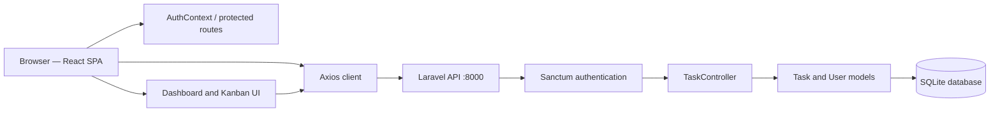
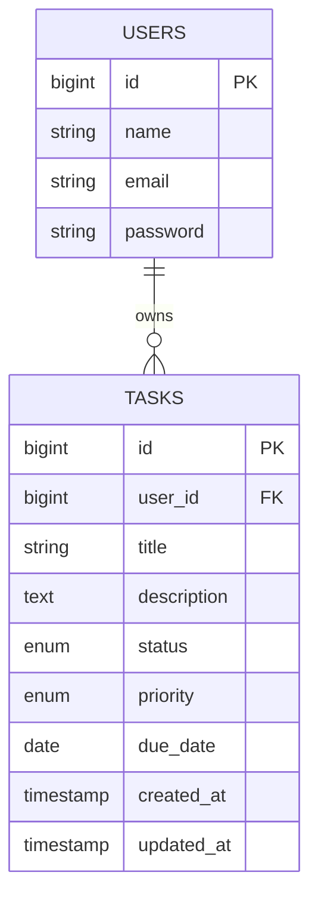

# Task Management — Laravel API + React Kanban

**A full-stack task management prototype with user-scoped REST APIs, Sanctum token authentication, and a drag-and-drop Kanban board.**

This project brings together a **Laravel 12** backend and a **React 19** single-page application. Users can authenticate, manage their own tasks, assign priorities and due dates, and move tasks between **To Do**, **In Progress**, and **Completed** columns.

The repository was developed as a frontend/backend integration and UI slicing exercise. Its core task workflow has source-code implementations; several additional navigation screens are still placeholders.

> **Status: development/learning project.** The source includes API routes, task CRUD, frontend authentication, and a Kanban board, but build status, API integration, and end-to-end functionality have not been revalidated in this README audit. It is **not** a finished collaborative or real-time project-management platform.

## Feature status

| Area | Implemented in source | Important limits |
| --- | --- | --- |
| API login and registration | Laravel Sanctum personal access tokens | Registration endpoint exists; there is **no working frontend registration route** |
| Frontend login/logout | React context, Axios auth interceptor, protected routes | Login currently redirects to a **nonexistent `/products` route**, which is then redirected to the dashboard |
| User-scoped task CRUD | Create, list, view, edit, and delete through Laravel API | All task lookups are constrained to the authenticated user |
| Kanban task board | Three status columns; create/edit modal; native HTML drag-and-drop | Dragging changes a task's status through an API request |
| Task properties | Title, description, status, priority, due date | Fixed status/priority values; no tags, attachments, or comments backend |
| Dashboard | Derived task counts and recent-task list from API data | Analytics charts are **placeholders** |
| Calendar, Tags, Shared, Chat, Settings | Routes and placeholder screens | No working scheduling, tagging, collaboration, messaging, or settings modules |
| Alternate task views | List/grid/calendar selectors are visible | The page still renders the Kanban board; selecting a different view does not implement that layout |
| Responsive styling | CSS/styled-components rules exist | Full mobile/keyboard/drag accessibility has not been verified |

**Not implemented:** WebSocket-based real-time synchronization, shared multi-user workspaces, a live chat service, push notifications, or a complete calendar application.

## Technology stack

| Layer | Technology |
| --- | --- |
| Backend | PHP **8.2+**, Laravel **12**, Eloquent ORM |
| Authentication | Laravel Sanctum **4** personal access / bearer tokens |
| Database | SQLite by default for local development |
| Frontend | React **19**, React Router DOM **7** |
| UI | styled-components **6**, CSS, Lucide icons |
| HTTP / client state | Axios, React Context, browser `localStorage` |
| Frontend tooling | Create React App / `react-scripts` **5** |
| Tests configured | PHPUnit **11** (backend); Jest/React Testing Library through CRA (frontend) |

Sanctum's personal access tokens are **not JWTs**. There is no automatic token-refresh flow in the inspected frontend code.

## Application architecture



### Backend

- `backend/routes/api.php` mounts `/api/user` and a protected `/api/tasks` resource.
- `backend/routes/auth.php` defines register/login/logout plus password recovery and verification-related endpoints.
- `backend/app/Http/Controllers/TaskController.php` validates tasks and reads/mutates them through `Auth::user()->tasks()`.
- `backend/app/Models/User.php` and `Task.php` define the owner–task relationship.
- `backend/database/migrations/` creates user/session-related tables, Sanctum personal access tokens, and tasks.

### Frontend

- `frontend/src/App.js` defines public and protected routes.
- `frontend/src/contexts/AuthContext.js` handles login, registration API calls, logout, and locally stored session state.
- `frontend/src/utils/api.js` sets the API origin and attaches the bearer token.
- `frontend/src/services/taskService.js` implements task API calls.
- `frontend/src/pages/TasksPage.js` renders the three-column Kanban UI and task editor.
- `frontend/src/pages/DashboardPage.js` computes counts and recent activity from fetched tasks.

The UI fetches data using HTTP requests after interactions. It does **not** subscribe to live updates from the backend.

## Getting started

### Requirements

- PHP **8.2+** and Composer.
- SQLite support in PHP (for the default local database).
- Node.js and npm compatible with the installed `react-scripts` 5 toolchain.
- Two terminal sessions: one for Laravel and one for React.

> **Run both applications from their own directories.** The repository does not provide a single cross-stack startup command.

### 1. Clone the repository

```bash
git clone https://github.com/alfrzhb/slicing_winnership.git
cd slicing_winnership
```

The default branch is `master`.

### 2. Configure the Laravel backend

```bash
cd backend
composer install
cp .env.example .env
php artisan key:generate
```

Use the supplied SQLite configuration:

```dotenv
APP_ENV=local
APP_DEBUG=true
APP_URL=http://localhost:8000
DB_CONNECTION=sqlite
FRONTEND_URL=http://localhost:3000
```

The supplied `backend/.env.example` already sets `DB_CONNECTION=sqlite`. Create an empty `backend/database/database.sqlite` **if it is not automatically created**, then run:

```bash
php artisan migrate
php artisan serve
```

The backend normally listens at **http://localhost:8000**. The API is under **`/api`**.

For local-only sample data, `php artisan db:seed` invokes a seeder that creates example users, including one with a predictable password. **Do not run this sample seeder on production or expose the demo credentials publicly.** You can instead create a test user with the `POST /api/register` endpoint.

### 3. Configure the React frontend

In a separate terminal from the repository root:

```bash
cd frontend
npm install
```

Configure the backend **origin** in `frontend/.env.local`, or review the existing `frontend/.env`:

```dotenv
REACT_APP_API_URL=http://localhost:8000
```

**Critical:** do **not** append `/api`. The Axios client uses this variable as its `baseURL`, and service/context calls already include paths such as `/api/login` and `/api/tasks`. Setting `http://localhost:8000/api` would make requests target `/api/api/...`.

The current frontend code falls back to `http://localhost:8000` when the variable is absent.

Start the frontend:

```bash
npm start
```

Open **http://localhost:3000** and sign in with a user created through the API (or a strictly local seeded user).

### 4. Development flow

1. Start Laravel and ensure the SQLite migrations are applied.
2. Start the React development server.
3. Register a user through the API if needed; the frontend currently has no working `/register` page.
4. Log in through the frontend's `/login` form.
5. Open **`/tasks`** to create, edit, delete, and drag tasks between status columns.
6. Open **`/dashboard`** for task counts and recent tasks.

For cross-origin errors, check `FRONTEND_URL` and [`backend/config/cors.php`](backend/config/cors.php). Restart affected development servers after changing their environment.

## Routes

### Frontend (React Router)

| Route | Description |
| --- | --- |
| `/login` | Login form |
| `/dashboard` | Task counts, status summaries, recent tasks, placeholder charts |
| `/tasks` | Kanban task board and CRUD modal |
| `/calendar` | Placeholder page |
| `/tags` | Placeholder page |
| `/shared` | Placeholder page |
| `/chat` | Placeholder page |
| `/settings` | Placeholder page |
| `/` and unmatched paths | Redirect to `/dashboard` |

The login page still links to `/register`, but `App.js` does **not** define this frontend route. The post-login navigation similarly targets `/products`, which is not defined; the wildcard route redirects it to `/dashboard`.

### Backend (REST)

| Method | Endpoint | Authentication | Purpose |
| --- | --- | --- | --- |
| `POST` | `/api/register` | Public | Create user and return a Sanctum token |
| `POST` | `/api/login` | Public | Authenticate and return a Sanctum token |
| `POST` | `/api/logout` | Bearer token | Revoke the current access token |
| `GET` | `/api/user` | Bearer token | Current user |
| `GET` | `/api/tasks` | Bearer token | List the current user's tasks |
| `POST` | `/api/tasks` | Bearer token | Create a task |
| `GET` | `/api/tasks/{id}` | Bearer token | View an owned task |
| `PUT/PATCH` | `/api/tasks/{id}` | Bearer token | Update an owned task |
| `DELETE` | `/api/tasks/{id}` | Bearer token | Delete an owned task |

Additional password-recovery and verification routes appear in `backend/routes/auth.php`; they are **not** integrated into a complete frontend recovery workflow.

### Example API requests

```http
POST /api/login
Content-Type: application/json
Accept: application/json

{
  "email": "your-user@example.com",
  "password": "your-local-password"
}
```

A successful login handler returns a JSON object containing `token` and `user`. Use that token in subsequent requests:

```http
POST /api/tasks
Authorization: Bearer <your-token>
Content-Type: application/json
Accept: application/json

{
  "title": "Review sprint backlog",
  "description": "Prioritize upcoming tasks",
  "status": "todo",
  "priority": "medium",
  "due_date": "2026-11-01"
}
```

Valid task values:

- **Status:** `todo`, `in_progress`, `completed`.
- **Priority:** `low`, `medium`, `high`.
- **Due date:** nullable date.

Defaults in the task migration are `todo` for status and `medium` for priority. All task resources are filtered through the authenticated user's task relation; other users' task IDs should not resolve.

## Database model



Laravel also maintains the framework/session/cache tables configured through its migrations and Sanctum's `personal_access_tokens` table. The application does **not** define a separate tags, comments, chat-messages, or shared-projects table.

## Commands and testing

### Backend

```bash
cd backend
php artisan route:list
php artisan migrate
php artisan test
```

Backend PHPUnit configuration is checked in under `backend/phpunit.xml`, along with authentication-related example feature tests. **Some checked-in authentication tests target `/login` instead of the actual `/api/login` route**; their assumptions should be reconciled before relying on a green suite.

### Frontend

```bash
cd frontend
npm start
npm run build
npm test
```

The checked-in `frontend/src/App.test.js` is still a **Create React App starter test** looking for "learn react", not a test of the current application. Meaningful integration and component tests should replace it.

**Audit scope:** these commands are defined in source/configuration, but no build, test, server startup, or browser run was executed during the README-only update.

## Repository structure

```text
slicing_winnership/
├── README.md
├── backend/
│   ├── .env.example
│   ├── artisan
│   ├── composer.json
│   ├── phpunit.xml
│   ├── app/
│   │   ├── Http/Controllers/
│   │   │   ├── Auth/
│   │   │   └── TaskController.php
│   │   └── Models/
│   │       ├── Task.php
│   │       └── User.php
│   ├── bootstrap/app.php
│   ├── config/cors.php
│   ├── database/
│   │   ├── migrations/
│   │   └── seeders/
│   ├── routes/
│   │   ├── api.php
│   │   ├── auth.php
│   │   └── web.php
│   └── tests/
└── frontend/
    ├── package.json
    ├── public/
    └── src/
        ├── App.js
        ├── components/
        │   ├── Header.js
        │   ├── Sidebar.js
        │   ├── ProtectedRoute.js
        │   └── PublicRoute.js
        ├── contexts/AuthContext.js
        ├── pages/
        │   ├── DashboardPage.js
        │   ├── TasksPage.js
        │   ├── LoginPage.js
        │   ├── CalendarPage.js
        │   ├── TagsPage.js
        │   ├── SharedPage.js
        │   ├── ChatPage.js
        │   └── SettingsPage.js
        ├── services/taskService.js
        ├── utils/api.js
        └── App.test.js
```

## Known issues and next steps

The points below are grounded in the checked-in source; runtime outcomes have **not** been independently verified.

1. **Authentication navigation:** login navigates to missing `/products`; sign-up links to missing `/register`. Redirect successful login to `/dashboard` and add a real registration page or remove the misleading link.
2. **Documentation/API URL mismatch:** earlier documentation appended `/api` to `REACT_APP_API_URL`, while Axios calls already contain that prefix. Configure the origin only.
3. **Incomplete modules:** calendar, tags, shared tasks, chat, and settings are placeholder pages, not finished backend-backed workflows.
4. **Inactive task controls:** alternate list/calendar views, the sort button, a task comment button, and the sidebar new-task button do not implement their advertised actions.
5. **Dashboard charts:** statistics and recent tasks are computed from API data, but the chart areas are placeholders rather than functional graph visualizations.
6. **Error handling for drag-and-drop:** `TaskService` returns `{ success: false }` for API failures; the drop handler refreshes tasks without checking that result. Failed status changes can be insufficiently explained to the user.
7. **No real-time synchronization:** updates come from fetching API data, not a WebSocket, SSE, or push channel.
8. **Token and frontend trust boundary:** bearer tokens and a user object are persisted in `localStorage`. Client-side route guards rely on that stored state; the backend's `auth:sanctum` remains the actual access-control boundary. Consider a production security review and stronger session handling.
9. **Scaffold/stale test expectations:** existing backend auth tests and frontend CRA sample test may not reflect the current API routes and UI. Add tests for ownership boundaries, auth, task CRUD, and status transitions.
10. **Seeded development account:** `DatabaseSeeder` includes an example account with a predictable password. Limit seed data to isolated local/test environments.
11. **Environment-file hygiene:** the repository contains a tracked `frontend/.env` file. Review tracked configuration before introducing any secrets. Client-side `REACT_APP_*` values must never contain private credentials.
12. **Production readiness:** evaluate mobile drag-and-drop, accessible keyboard alternatives, date serialization, CORS, and deployment configuration before production.

### Suggested improvement order

- **P0:** Fix auth redirects and implement or remove the signup link.
- **P0:** Correct configuration instructions and verify Laravel/React integration locally.
- **P1:** Add realistic test coverage for API authentication, owner scoping, and task CRUD.
- **P1:** Fix task-status update feedback and complete the visible Kanban controls.
- **P2:** Implement real calendar/search/filter screens only when required; clearly mark unfinished routes.
- **P2:** Harden token handling, responsive accessibility, and production deployment.

## References and licensing

- [Original explanation video](https://youtu.be/wo5u8nU3qX8) *(linked in the previous README; current availability was not verified)*.
- [UI design inspiration](https://dribbble.com/shots/19756046-To-Do-List-Desktop-App) *(original reference)*.
- [Laravel](https://laravel.com/) · [React](https://react.dev/) · [Laravel Sanctum](https://laravel.com/docs/sanctum).

No root `LICENSE` file was found in the inspected repository tree. Although the Laravel application template declares an MIT license in its Composer metadata, **do not assume a repository-wide or asset-wide license without an explicit grant**.

---

**Repository:** [alfrzhb/slicing_winnership](https://github.com/alfrzhb/slicing_winnership) · **Branch:** `master`

This document reflects inspected code and current limitations rather than unverified completion claims.
